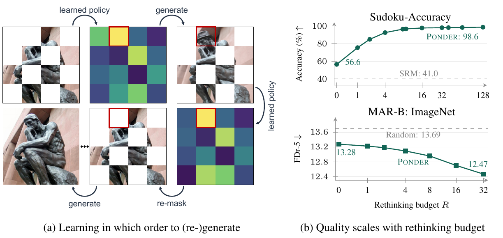
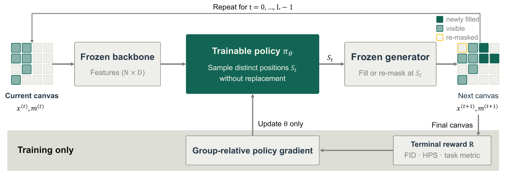

<div align="center">

# PONDER: Learning to Generate in the Right Order

[Julius Erbach](https://juliuserbach.github.io/)<sup>1,2</sup>,
[Dominik Narnhofer](https://scholar.google.com/citations?hl=en&user=tFx8AhkAAAAJ)<sup>1</sup>,
[Bernt Schiele](https://www.mpi-inf.mpg.de/departments/computer-vision-and-machine-learning/people/bernt-schiele)<sup>2</sup>,
[Jan Eric Lenssen](https://geometric-rl.mpi-inf.mpg.de/)<sup>2,3</sup>,
[Konrad Schindler](https://scholar.google.ch/citations?hl=en&user=FZuNgqIAAAAJ)<sup>1</sup>

<sup>1</sup>ETH Zurich &nbsp; <sup>2</sup>Max Planck Institute for Informatics &nbsp; <sup>3</sup>Saarland University

[](https://arxiv.org/abs/2610.23531)
[](https://juliuserbach.github.io/ponder-page/)
[](https://huggingface.co/juliuse/ponder)



</div>

PONDER learns the order in which a frozen masked generator fills in its
tokens. A small transformer policy reads the generator's own features and picks
the positions to generate next. With *rethinking*, it can also mask positions
that are already generated, so they are generated again once more context is
available. The policy is trained with GRPO on a reward for the finished
sample. The generator is never changed. For FID, which has no per-sample
value, we introduce the **FIDgrad** reward.

This repository has the code and policies for the paper's three settings:
Visual Sudoku, MAR-B on ImageNet 256 and MaskGen-KL-XL text-to-image.

## Setup

```bash
pip install -e .           # Sudoku
pip install -e ".[mar]"    # MAR-B
# MaskGen-KL-XL (ImageReward's setup.py still needs setuptools < 81)
echo "setuptools<81" > /tmp/constraints.txt
PIP_CONSTRAINT=/tmp/constraints.txt pip install -e ".[maskgen,maskgen-eval]"

# Our policies and the Sudoku generator and data
hf download juliuse/ponder --include "checkpoints/*" "data/*" --local-dir .
```

MAR-B and MaskGen-KL-XL also need their original code and weights:

```bash
# MAR-B, its VAE and the FID reference statistics
git clone https://github.com/LTH14/mar external/mar && git -C external/mar checkout c6d53f7
git clone https://github.com/Jiawei-Yang/FD-Loss external/FD-Loss && git -C external/FD-Loss checkout 5c03b81
hf download jjiaweiyang/FD-Loss --revision 88ce2bb4061b0dd58839a1827235ffcffa51eed2 \
    --include "data/fid_stats/*" --local-dir external/FD-Loss
(cd external/FD-Loss && python scripts/extract_paper_ref_stats.py)
(cd external/mar && python -c "from util.download import *; download_pretrained_vae(); download_pretrained_marb()")
mkdir -p checkpoints/mar && mv external/mar/pretrained_models/mar/mar_base/checkpoint-last.pth \
    external/mar/pretrained_models/vae/kl16.ckpt checkpoints/mar/

# MaskGen-KL-XL (its weights download on first use) and HPSv2.1
git clone https://github.com/bytedance/1d-tokenizer external/1d-tokenizer && git -C external/1d-tokenizer checkout 942a96f
hf download xswu/HPSv2 HPS_v2.1_compressed.pt --local-dir checkpoints
```

## Evaluation

Each script evaluates our policy by default. `--budgets` sets the rethinking
budgets R, `--policy random` gives random order and `--policy <file>` loads
another policy. For a quick check, `--boards-per-difficulty`, `--samples` and
`--prompts` run on fewer boards, samples and prompts.

```bash
python scripts/eval_sudoku.py --budgets 0 9                      # solve rate, ~7 min on one GPU
torchrun --nproc-per-node=8 scripts/eval_mar.py --budgets 0 32   # FID, IS, FDr-5 on 50k samples
python scripts/eval_maskgen_hps.py --budgets 0 4                 # HPSv2.1, PickScore, ImageReward
```

GenEval images are scored with the official GenEval code, packaged in the
[`geneval_server`](geneval_server) Docker image (the scoring commands are in its
Dockerfile):

```bash
git clone https://github.com/djghosh13/geneval external/geneval && git -C external/geneval checkout af4902f
python scripts/eval_maskgen_geneval.py --budgets 0 4 \
    --metadata external/geneval/prompts/evaluation_metadata.jsonl --output runs/geneval
docker build -t ponder-geneval geneval_server
```

## Training

Each config in [`configs/`](configs) has the recipe of one of our policies.
Trailing `key=value` arguments override config entries, and rerunning a
command resumes it.

```bash
torchrun --nproc-per-node=2 -m ponder.train configs/sudoku.yaml --output runs/sudoku
torchrun --nproc-per-node=8 -m ponder.train configs/mar.yaml --output runs/mar
torchrun --nproc-per-node=4 -m ponder.train configs/maskgen_hps.yaml --output runs/maskgen_hps
```

The GenEval reward needs Flow-GRPO's training prompts and the reward server
from the same Docker image:

```bash
wget -O data/geneval_train_metadata.jsonl https://raw.githubusercontent.com/yifan123/flow_grpo/879042cf5707f8b90daa98d147d7deac2317c5da/dataset/geneval/train_metadata.jsonl
# one server worker per GPU
docker run -d --gpus all -p 127.0.0.1:18085:18085 ponder-geneval \
    python3.10 -m gunicorn --bind 0.0.0.0:18085 --workers 4 "app_geneval:create_app()"
torchrun --nproc-per-node=4 -m ponder.train configs/maskgen_geneval.yaml --output runs/maskgen_geneval
```

## Your own generator

<p align="center"></p>

PONDER works with any masked generator that fills positions from noise, given
the visible ones. The sampler ([`ponder/sampler.py`](ponder/sampler.py)), the
policy ([`ponder/policy.py`](ponder/policy.py)) and the GRPO update
([`ponder/grpo.py`](ponder/grpo.py)) never look inside the generator. You
write two small classes in one new file, `ponder/generators/<name>.py`, and a
config. [`ponder/generators/sudoku.py`](ponder/generators/sudoku.py) is the
shortest complete example. [`mar.py`](ponder/generators/mar.py) and
[`maskgen.py`](ponder/generators/maskgen.py) are the other two.

**1. An adapter around your frozen generator.** Every round, the sampler
calls `contextualize` once, lets the policy pick K positions from the features
it returns, and calls `sample` to fill them. Tokens are continuous vectors of
width D.

```python
class MyAdapter:
    def contextualize(self, canvas, visible, cond):
        # canvas [B,N,D]: the current tokens. only positions with visible [B,N] == True are valid.
        # cond: whatever your Task.batch returns (class labels, text embeddings, ...).
        #   Training slices it per microbatch as cond[rows], so use a tensor or a class
        #   with __getitem__ (see Text in maskgen.py).
        # Run the backbone once, with mask tokens at the positions that are not visible.
        hidden = self.backbone(canvas, visible, cond)  # [B,N,F]
        # Return (policy features [B,N,F], context for sample). The per-position vector
        # that conditions the token head is a good choice for both.
        return hidden, hidden

    def sample(self, context, positions, noise, masked_after):
        # positions [B,K]: the positions picked this round.
        # noise [B,K,D]: Gaussian noise for exactly these fills. The policy has seen it,
        #   so the fill should be a deterministic function of it (e.g. DDIM or an ODE).
        # masked_after [B]: positions still masked after this round, for schedules such as
        #   MaskGen's CFG. ignore it if you don't need it.
        condition = context.gather(1, positions[..., None].expand(-1, -1, context.shape[-1]))
        return self.token_head(condition, noise)  # new tokens [B,K,D]

    def decode(self, canvas, cond):
        # The finished tokens [B,N,D] -> what the reward looks at (rollout.images).
        return self.vae.decode(canvas)
```

**2. A task: what to generate and how to score it.**
[`ponder/train.py`](ponder/train.py) imports it by the config's `task` name.
The reward is any function of the finished samples.

```python
import torch
from ponder.schedules import Schedule

class Task:
    positions = 256    # N, tokens per sample
    token_width = 16   # D, width of a token and of its noise

    def __init__(self, config, device, seed):
        # config is the `<name>:` section of the YAML file.
        self.adapter = MyAdapter(config["checkpoint"], device)
        self.removals = config["removals"]    # rethinking budget R
        self.noise_capacity = self.removals   # refills per position that get fresh noise
        self.device = device

    def batch(self, update, group_ids):
        # group_ids [B]: one id per rollout. A GRPO group is a run of equal ids. Members of a
        # group share the condition and the generator noise, so their rewards differ only by
        # the policy's choices. Derive per-group data from the id to keep runs reproducible.
        size = len(group_ids)
        cond = group_ids % 1000  # e.g. one class label per group
        canvas = torch.zeros(size, self.positions, self.token_width, device=self.device)
        writable = torch.ones(size, self.positions, dtype=torch.bool, device=self.device)
        # canvas holds given tokens (e.g. Sudoku clues) where writable is False.
        decisions = self.positions + 2 * self.removals
        schedule = Schedule(self.positions, self.removals, (1,) * decisions)  # see below
        return schedule, cond, canvas, writable

    def reward(self, rollout, cond, group_ids):
        return my_score(rollout.images, cond)  # one float per rollout [B]

    def state_dict(self):  # anything that must survive a resume, e.g. FIDgrad's moments
        return {}

    def load_state_dict(self, state):
        pass
```

**The schedule.** `Schedule(positions, removals, commits)` fixes how a
rollout is split into rounds ([`ponder/schedules.py`](ponder/schedules.py)):

- `positions`: N, the number of writable positions.
- `removals`: R, the rethinking budget. Every removal re-masks a generated
  position, which is then filled again later, so a rollout makes N + 2R
  decisions: N + R fills and R removals.
- `commits`: the number of decisions in each round. They must sum to N + 2R.
  Each round costs one backbone pass and uses the policy's first
  `commits[r]` action heads. The policy decides which decisions remove. The
  sampler only keeps the total at exactly R and makes the last round fill.

For example, `Schedule(32, 4, (1,) * 40)` makes one decision per round,
as for MaskGen. `mar_schedule`, `maskgen_schedule` and `sudoku_schedule` are
the schedules of the paper.

**3. A config.** Copy one from [`configs/`](configs), set `task: <name>`,
put your task's options in a `<name>:` section and set the policy's
`input_width` to F + D and its `action_heads` to the largest number of
decisions in a round.

To sample with a trained policy:

```python
import torch
from ponder.generators.mine import Task
from ponder.noise import NoiseBank
from ponder.policy import load_policy
from ponder.sampler import sample
from ponder.train import load_config

config = load_config("configs/mine.yaml")
task = Task(config["mine"], torch.device("cuda"), seed=0)
policy = load_policy("runs/mine/policy_010000.pt")
group_ids = torch.arange(16, device="cuda")  # 16 samples, each its own group
schedule, cond, canvas, writable = task.batch(0, group_ids)
noise = NoiseBank(0, group_ids, 1, task.positions, task.token_width, task.noise_capacity)
with torch.autocast("cuda", dtype=torch.bfloat16):
    images = sample(task.adapter, policy, schedule, noise, cond, canvas, writable).images
```

## FIDgrad

FID compares whole distributions, so a single sample has no FID. FIDgrad
scores a sample by how much FID would drop if the sample were added to the
current distribution of generated samples. It is the first-order change of FID
in closed form, computed from the Inception mean and covariance of the
generated and the real images ([`ponder/fidgrad.py`](ponder/fidgrad.py)).

It needs three things:

- **Inception features** of the samples: `load_inception` and
  `inception_features` use FD-Loss's TF-compatible Inception-v3, the network of
  the standard FID.
- **Real statistics**: the Inception mean and covariance of the real data. For
  ImageNet 256 these are the ADM reference statistics from FD-Loss.
- **Initial generated statistics.** The reward is relative to the current
  generated distribution, so it needs an estimate of that distribution before
  the first update: the mean and raw second moment E[z zᵀ] of the Inception
  features of about 50k samples from the frozen generator in random order
  (close to what the untrained policy generates). For MAR-B this is
  `checkpoints/mar_fidgrad_init.npz` on Hugging Face.
  [`scripts/build_fidgrad_init.py`](scripts/build_fidgrad_init.py) rebuilds it
  and is the template for other generators.

During training, the generated statistics follow the policy as an exponential
moving average in which each new batch has weight 0.001. Every batch is scored
before it updates them, and one rollout of each GRPO group enters the update.
They are saved with the training checkpoint, so resumed runs continue with them.

```python
import numpy as np
from ponder.fidgrad import FIDgrad, inception_features, load_inception

class Task:
    def __init__(self, config, device, seed):
        ...
        self.seed = seed
        self.inception = load_inception("external/FD-Loss", device)
        real = np.load("real_stats.npz")       # mu [2048], sigma [2048,2048]
        init = np.load("fidgrad_init.npz")     # generated_mean, generated_raw_second_moment
        self.fidgrad = FIDgrad(real["mu"], real["sigma"], init["generated_mean"],
                               init["generated_raw_second_moment"], ema_decay=0.001, device=device)

    def reward(self, rollout, cond, group_ids):
        features = inception_features(self.inception, rollout.images.float())
        return self.fidgrad.reward(features, group_ids, self.seed)  # scores, then updates

    def state_dict(self):
        return {"fidgrad": self.fidgrad.state_dict()}

    def load_state_dict(self, state):
        self.fidgrad.load_state_dict(state["fidgrad"])
```

## Citation

```bibtex
@article{erbach2026ponder,
  title   = {{PONDER}: Learning to Generate in the Right Order},
  author  = {Erbach, Julius and Narnhofer, Dominik and Schiele, Bernt and Lenssen, Jan Eric and Schindler, Konrad},
  journal = {arXiv preprint arXiv:2610.23531},
  year    = {2026}
}
```

## Acknowledgements

We build on [MAR](https://github.com/LTH14/mar),
[MaskGen / TA-TiTok](https://github.com/bytedance/1d-tokenizer),
[FD-Loss](https://github.com/Jiawei-Yang/FD-Loss), [HPSv2](https://github.com/tgxs002/HPSv2),
[PickScore](https://github.com/yuvalkirstain/PickScore), [ImageReward](https://github.com/THUDM/ImageReward),
[GenEval](https://github.com/djghosh13/geneval), [Flow-GRPO](https://github.com/yifan123/flow_grpo)
and [SRM](https://github.com/Chrixtar/SRM) (Wewer et al., ICML 2025), whose Sudoku data and digit classifier we use.
The code is released under the [MIT license](LICENSE).
